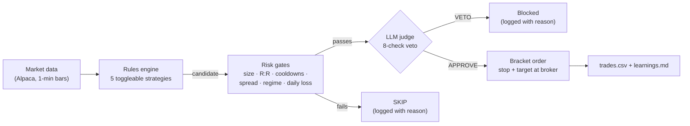

# stockbot


**A rules engine finds the setup. A local LLM gets veto power.**

stockbot is an intraday trading bot for Alpaca. Deterministic Python finds the setups and sizes the trades. An LLM (by default a local model in LM Studio) reviews each candidate against an 8-point checklist and can only say **no**: it can't create a trade, change the config, or override a risk gate. Every yes and every no is logged with the reason.

Full video with sound: [`brag-output/brag.mp4`](brag-output/brag.mp4)

> [!WARNING]
> **Not financial advice. Use at your own risk.**
> This is a hobby project shared for learning and experimentation. It is **not** investment advice, and nothing here suggests the strategies make money. The author's own paper results (below) are **negative**. stockbot runs on **paper trading by default**. If you choose to trade real money with it, every loss is yours. Read the code before you trust it.

---

## How it works



1. **Rules engine** (`strategies.py`): pure math, no LLM, no I/O. Any missing or ambiguous data means skip.
2. **Risk gates** (`main.py`, `filters.py`, `structure.py`): position sizing, reward:risk band, symbol cooldowns, spread/ATR/regime filters, sector and exposure caps, and a daily-loss shutoff. These run before the LLM ever sees the trade.
3. **LLM judge** (`judge.py`): gets a pre-computed summary and must answer `CHECK 1..8: PASS/FAIL` plus `VERDICT: YES/NO`. It is **fail-closed**: a timeout, an error, an off-format answer, or any FAILed check means veto. It has no file-writing code at all, so it structurally can't touch `config.yaml`.
4. **Execution** (`broker.py`): a real Alpaca bracket order (stop-loss and take-profit live at the broker), plus a software monitor as a backup.

What a decision looks like, from the included paper log ([`sample_logs/decision_log_2026-08-13.log`](sample_logs/decision_log_2026-08-13.log)):

```text
[13:24:31] CANDIDATE NKE support_hold long entry~41.09 SL 40.91 TP 41.37 -> asking judge
[13:24:32] VETO NKE support_hold: AVOID line in REPLAY PLAYBOOK matches trade details.
[11:00:08] CANDIDATE KO higher_low long entry~87.69 SL 87.43 TP 88.09 -> asking judge
[11:00:09] APPROVED by judge: All checks pass with the given trade summary and learnings.
[11:00:11] ENTERED LONG 136 KO @ 87.70 (SL 87.43 / TP 88.09) [broker bracket + software backup]
```

---

## Quickstart (paper trading)

You need Python 3.10+ (tested on 3.10 and 3.12) and a free [Alpaca](https://app.alpaca.markets) account. Switch the account picker to **Paper** and generate API keys there.

```bash
git clone https://github.com/Vedthakar/stockbot.git
cd stockbot
python3 -m venv .venv
source .venv/bin/activate
pip install -r requirements.txt
cp .env.example .env
```

Open `.env` and paste your **paper** `ALPACA_API_KEY` and `ALPACA_SECRET_KEY`. Then:

```bash
python broker.py
```

That's a read-only connection check. It should end with `connection test PASSED`.

```bash
python main.py --no-judge
```

That runs the rules engine alone, no model needed. It waits for the 9:30 ET open (or exits if the market is closed today), trades the paper account, and flattens everything by 15:55.

### Add the LLM veto (local, no API key)

1. Install [LM Studio](https://lmstudio.ai), download a chat model, and start the local server (Developer tab → Start Server, or `lms server start`).
2. In `config.yaml`, set `judge.model` to the model's id (`lms ls` shows it).
3. Run:

```bash
python main.py
```

On startup the bot checks that the judge answers. If it doesn't, you'll see a warning, and every candidate is vetoed until it does. That's fail-closed by design; use `--no-judge` to trade rules-only. Small local models can take tens of seconds per veto. To use a hosted model instead, the `judge:` section of `config.yaml` also has a Groq setup.

### Other commands

```bash
python main.py --help
python dashboard.py
python -m unittest test_safety test_bot test_trainer
python sample_logs/summarize.py
```

`dashboard.py` is a local web UI at http://localhost:8000 (positions, trades, Start/Pause/Stop). The other two run the test suite and print the paper results below from the included log.

---

## How it learns from every trade

stockbot has two feedback loops. Neither one ever edits `config.yaml`; only you change the rules.

**1. After every live trade.** When a position closes, the judge writes a post-trade journal entry to `learnings.md`: the setup, why it was taken, what happened, and why it worked or failed. The bot feeds the recent entries for that strategy back to the judge on every new candidate. Two concrete guards are built on top:

- **Same day:** after 2 losses on the same ticker + strategy, Python blocks that combo for the rest of the day, before the LLM is asked (`entry_guards.max_combo_losses_per_day`).
- **Across days:** the judge's CHECK 4 fails any setup with 2 or more logged losses on the same ticker + strategy.

**2. Night school (`trainer.py`).** While the market is closed, the bot replays past sessions with the exact production detectors. On every setup it finds, it quizzes the judge to predict WIN or LOSS *before* revealing the outcome, then writes a lesson grading that call (`replay_learnings.md`). Every replayed setup also feeds statistics per strategy / direction / market regime / time of day. Once a bucket has at least 20 replays, it becomes a line in `playbook.md`:

```text
AVOID: long in chop during afternoon_1400_close — 49 replays, expectancy -0.43R
```

The live judge reads the playbook, and its CHECK 8 vetoes any trade that matches an AVOID line. That's where vetoes like `AVOID line in REPLAY PLAYBOOK matches trade details` in the sample log come from.

```bash
python trainer.py --cycles 1
python trainer.py --no-llm
```

The first runs one study cycle; the second does replay and statistics only, with no LLM calls. With no flags, it trains until shortly before the next market open. The trainer refuses to run while the market is open.

This is learning in a narrow, statistical sense: it filters setups that have lost before. It does not guarantee the bot won't lose again, and the paper results below lost money while both loops were running.

## Strategies

Turn each strategy on or off in the `strategies:` block at the top of `config.yaml`. Its tuning parameters live further down the same file. Full rules are in [`TRADING_STRATEGY.md`](TRADING_STRATEGY.md).

| Strategy | Side | What the rules engine looks for | Default |
|---|---|---|---|
| `higher_low` | long | On 5-min bars, a confirmed swing low above the prior swing low, then a bullish close above that candle's high | on |
| `support_hold` | long | Price consolidates at a multi-touch support level without closing below it, then a bullish confirmation candle | on |
| `support_break` | short | A 5-min close at least 0.10% below support on 1.5× relative volume (blocked on `trend_up` days) | off |
| `ob_fvg` | long | Impulse candle, then price retests both a fair value gap and the order-block midpoint | off |
| `opening_scalp` | both | The 9:30–9:45 range breaks on a 5-min close with volume, then a 1-min retest holds; no new breakouts after 11:00 | on |

Every strategy lost money in the author's paper log (`sample_logs/paper_trades.csv`), including the ones that ship on. `support_break` and `ob_fvg` are off because the author turned them off during that period, not because the others were shown to work.

---

## Safety defaults

| | |
|---|---|
| **Paper by default** | `python main.py` only ever talks to `paper-api.alpaca.markets`. No config value or env var can switch it to live. |
| **Live = flag + typed confirmation** | `python main.py --live` asks you to type `I UNDERSTAND THIS IS REAL MONEY` at an interactive terminal. With no terminal (cron, piped input), it refuses. |
| **Secrets in env only** | Keys, endpoints and account IDs come from `.env` (see `.env.example`). Optionally set `ALPACA_EXPECTED_ACCOUNT_ID` and the bot refuses to start against any other account. |
| **Judge is optional, never fail-open** | `judge.enabled: false` or `--no-judge` means rules only. While enabled, any judge failure means veto. |
| **Hard risk caps** | Per-trade risk, a per-order notional ceiling, max open positions, gross exposure, and a daily-loss shutoff, all in `config.yaml` → `risk`. |
| **Learnings are advisory** | The bot writes post-trade notes, but it never edits its own parameters. Only you change `config.yaml`. |

---

## Paper results (from the included log)

Every number here comes from running `python sample_logs/summarize.py` on [`sample_logs/paper_trades.csv`](sample_logs/paper_trades.csv). That file is the author's complete trade log (not a cherry-picked subset) from an **Alpaca paper account**, so it's simulated fills, not real money. It covers 2026-07-20 to 2026-08-19, and strategies and settings changed during that period.

```text
rows              : 242
  vetoed          : 157
  approved        : 76
  failed_sanity   : 6
  closed_external : 3
LLM vetoes        : 157 (38 of them fail-closed because the judge was unreachable)
closed trades     : 79
winners           : 27 (34%)
net paper P&L     : $-1,231.29
```

**These paper results lost money.** Treat stockbot as a framework for experimenting with rules plus an LLM veto, not as a strategy that works. In that period the judge was a hosted Llama 3.3 70B (Groq). The default config now points at a local model.

The log contains no account identifiers. Each row is one decision: ticker, strategy, prices, outcome, `veto_decision`, and the judge's reason.

---

## Project layout

| File | What |
|---|---|
| `config.yaml` | every tunable parameter, including strategy on/off switches |
| `.env.example` | template for keys, endpoints and account ID (copy to `.env`) |
| `main.py` | poll loop, risk gates, judge call, execution, CLI flags |
| `strategies.py` | one deterministic detector per strategy |
| `judge.py` | LLM veto gate + journal writer (no file I/O) |
| `broker.py` | Alpaca wrapper; `python broker.py` is a connection self-test |
| `filters.py`, `structure.py` | context gates and structure-based stop/target placement |
| `dashboard.py` | local web dashboard |
| `backtest.py`, `trainer.py` | historical replay and offline "night school" for the judge |
| `sample_logs/` | sanitized paper-trading logs + `summarize.py` |
| `TRADING_STRATEGY.md` | the strategy spec the code implements |

Your own runs write `trades.csv`, `learnings.md` and `bot.log` locally. These are gitignored.

## License

[MIT](LICENSE). Not financial advice; the software is provided as-is, with no warranty.
